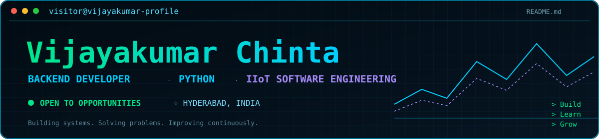

 <div align="center">




[GitHub](https://github.com/VijayaKumarchinta) · [LinkedIn](https://www.linkedin.com/in/vijaya-kumar-chinta-4a9551251/) · [Portfolio](https://vijayakumarchinta-portfolio.pages.dev) · [Email](mailto:vijayakumar.chinta15@gmail.com)

</div>

---

<table>
<tr>
<td width="33%" valign="top">

### `$ whoami`

```yaml
name: Vijayakumar Chinta
role: Backend Developer
experience: Fresher / Entry-level
location: Hyderabad, India
education: B.Tech
specialization:
  - Backend Engineering
  - Data Science
  - Industrial IoT
```

</td>
<td width="34%" valign="top">

### `$ system --status`

```text
● Python
● Flask / Django
● PostgreSQL
● REST APIs
● MQTT / TLS
● Vue.js
○ System Design
```

</td>
<td width="33%" valign="top">

### `$ /about`

Backend-focused developer interested in building maintainable applications, database-driven systems, APIs and practical IIoT solutions.

I enjoy understanding how software behaves beyond the happy path: validation, failure handling, data integrity and operational reliability.

</td>
</tr>
</table>

## `$ ls -la ./projects`

| # | Featured Project | Technology Stack | Engineering Focus |
|---|---|---|---|
| 01 | [Portfolio Website](https://github.com/VijayaKumarchinta/portfolio) | Vue 3 · Vite · Tailwind · Three.js | Interactive portfolio and frontend engineering |
| 02 | [AI-Powered Profile Builder](https://github.com/VijayaKumarchinta/famous-person-profile-agent) | React · TypeScript · Tailwind · Wikipedia API | AI-assisted profile generation and information extraction |
| 03 | [Customer Segmentation Dashboard](https://github.com/VijayaKumarchinta/Customer_seg) | Python · Pandas · Scikit-learn · Streamlit | RFM analysis, K-Means clustering and customer analytics |
| 04 | [Haett MLOps Assessment](https://github.com/VijayaKumarchinta/Haett_MLOps_Intern_Assessment_) | FastAPI · MLflow · Feast · Airflow · Docker | Churn prediction, feature stores and model monitoring |
| 05 | [Sales Analytics Platform](https://github.com/VijayaKumarchinta/Sales_analytics) | Vue 3 · Pinia · Cloudflare Workers · D1 | Sales analytics, profitability and secure authentication |
| 06 | [Order & Sales Management](https://github.com/VijayaKumarchinta/Intern_Training/tree/main/Order_Sales_Management) | Vue 3 · Flask · PostgreSQL | Order lifecycle, validation, authentication and reporting |
| 07 | [Machine Sensor API — IIoT](https://github.com/VijayaKumarchinta/Intern_Training/tree/main/MQTT/Machine_Sensor_API) | Python · Flask · PostgreSQL · MQTT | Sensor ingestion, secure messaging and data persistence |

## `$ ./experience`

### Triniti Advanced Software Labs Pvt. Ltd.

<sub>Intern · August 2026 – Present</sub>

- Working with Flask and PostgreSQL for sensor-data workflows.
- Exploring MQTT over TLS/mTLS using Mosquitto and Paho.
- Applying connection pooling, timeouts and structured logging.
- Practising API validation, data integrity and backend testing.

### Bean Infosystems

<sub>Intern · May 2024 – June 2024</sub>

- Worked with foundational JavaScript, Java, HTML and CSS.
- Practised debugging and database-related development tasks.
- Collaborated on implementation and technical documentation.

## `$ ./tech-stack`

<div align="center">

**Programming Languages**


**Backend & Databases**


**Frontend & Development Tools**


</div>

| Category | Technologies |
|---|---|
| Languages | Python, JavaScript, Java, SQL |
| Backend | Flask, Django, FastAPI, REST APIs |
| Frontend | Vue 3, HTML, CSS, Tailwind CSS |
| Databases | PostgreSQL, Cloudflare D1 |
| Data Science | Pandas, NumPy, Scikit-learn |
| IIoT | MQTT, Mosquitto, Paho, TLS/mTLS |
| Tools | Git, GitHub Actions, Postman, Docker, VS Code |

## `$ ./education`

**Koneru Lakshmaiah Education Foundation (KL University)**

B.Tech — Data Science and Big Data Analytics

- July 2022 – May 2026
- CGPA: 8.8

## `$ ./certifications`

- AWS Certified Cloud Practitioner — AWS (September 2024)
- Salesforce Certified AI Associate — Salesforce (October 2024)
- Automation Anywhere Certified Essentials RPA Professional (2023)

## `$ github --stats`

<div align="center">

<a href="https://github.com/VijayaKumarchinta">

</a>

<a href="https://github.com/VijayaKumarchinta">

</a>


</div>

## `$ git log --contributions`

<div align="center">


</div>

## `$ ./learning-roadmap`

```text
[+] Backend engineering and REST API design
[+] Relational database design and SQL
[+] Reliable data ingestion and validation
[+] Industrial IoT application workflows
[ ] System design fundamentals
[ ] Observability and production operations
```

## `$ connect`

<div align="center">

<a href="https://github.com/VijayaKumarchinta">

</a>

<a href="https://www.linkedin.com/in/vijaya-kumar-chinta-4a9551251/">

</a>

<a href="https://vijayakumarchinta-portfolio.pages.dev">

</a>

<a href="mailto:vijayakumar.chinta15@gmail.com">

</a>

</div>

<div align="center">

```text
SESSION: visitor@vijayakumar-profile
STATUS: READY
$ _
```

<sub>Building systems. Solving problems. Improving continuously.</sub>

</div>